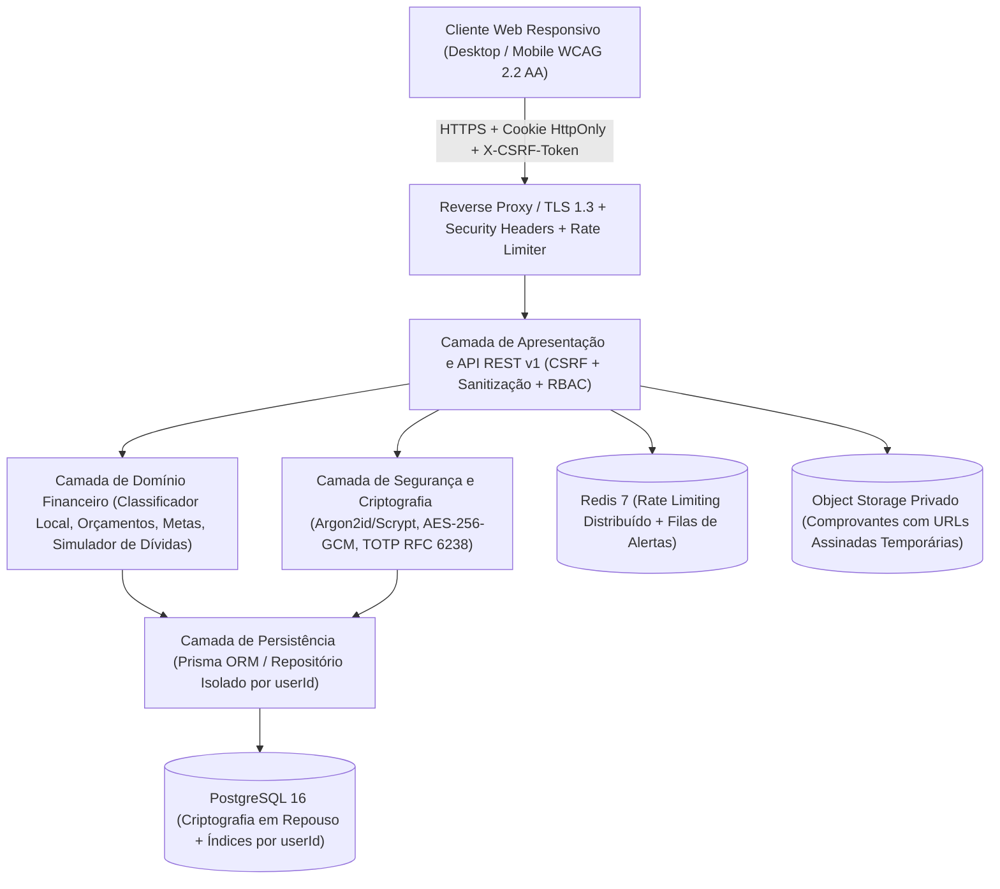

# Documento de Arquitetura de Software — Meu Controle Financeiro

## 1. Visão Arquitetural

A plataforma **Meu Controle Financeiro** foi desenhada com uma arquitetura modular em camadas orientadas ao domínio financeiro pessoal, priorizando **isolamento multi-tenant por usuário**, **segurança defensiva em profundidade**, **baixa latência** e **conformidade nativa com a LGPD**.

---

## 2. Separação em Camadas

1. **Camada de Interface e Acessibilidade (`src/server/ui-template.ts`, `src/app/`)**:
   - Interface responsiva (barra lateral fixa no desktop e barra inferior no celular).
   - Conformidade **WCAG 2.2 AA**: navegação por teclado, *skip-link*, foco visível de alto contraste, atributos `aria-*` em barras de progresso e modo claro/escuro.
   - Formatação estrita no padrão brasileiro (`R$ 1.234,56` e `dd/mm/aaaa`).
2. **Camada de Controle de Borda e Guardas (`src/lib/security/headers-and-guards.ts`, `src/server/app-server.ts`)**:
   - Aplica cabeçalhos HTTP obrigatórios (`Strict-Transport-Security`, `Content-Security-Policy`, `X-Content-Type-Options: nosniff`, `X-Frame-Options: DENY`, `Referrer-Policy`, `Permissions-Policy`).
   - Proteção anti-CSRF baseada em HMAC-SHA256 vinculado à sessão.
   - Validação de uploads de anexos verificando *Magic Bytes* reais (PDF, PNG, JPEG), tamanho máximo (5 MB) e checksum SHA-256.
3. **Camada de Domínio Financeiro (`src/lib/finance/`)**:
   - **Classificador Inteligente (`smart-classifier.ts`)**: analisa descrições de lançamentos e aprende localmente com correções manuais do usuário (`learnedCategoryRulesJson`), sem exportar dados pessoais para modelos externos.
   - **Simuladores e Projeções (`simulators.ts`)**: cálculo de orçamentos mensais (alertas em 50%, 80%, 100% e excesso), projeção de metas financeiras e simulador de quitação de dívidas (*Avalanche* vs. *Bola de Neve*).
4. **Camada de Persistência e Isolamento de Dados (`prisma/schema.prisma`, `src/lib/store/database.ts`)**:
   - 22 entidades relacionais normalizadas.
   - Valores monetários armazenados sempre em **centavos inteiros** (`BigInt` / `integer`) para eliminar erros de ponto flutuante IEEE 754.
   - Verificação obrigatória `assertOwnership(resource.userId, actorUserId)` em 100% das leituras e mutações.

---

## 3. Separação de Ambientes e Infraestrutura

| Ambiente | Finalidade | Dados Permitidos | Gerenciamento de Segredos |
| :--- | :--- | :--- | :--- |
| **Desenvolvimento (`development`)** | Desenvolvimento local e testes automatizados | Exclusivamente dados fictícios (`[EXEMPLO / DEMO]`) | Variáveis locais `.env` (nunca versionadas) |
| **Homologação (`staging`)** | Testes integrados, QA, testes de carga e acessibilidade | Dados sintéticos anonimizados | Cofre de segredos dedicado de homologação |
| **Produção (`production`)** | Uso real pelos titulares | Dados reais criptografados em trânsito e em repouso | KMS / Secret Manager com rotação automática a cada 90 dias |

---

## 4. Observabilidade e Auditoria

- **Logs Estruturados e Mascarados**: IPs são mascarados (`177.45.xxx.xxx`), e-mails são parcialmente ocultados (`ma***@dominio.com`) e campos sensíveis (`password`, `token`, `secret`, `totp`, `cvv`) são automaticamente substituídos por `[REDACTED]` antes da gravação.
- **Trilha de Auditoria (`AuditLog`)**: Registra login, logout, ativação de MFA, redefinição de senha, revogação de sessões, exportação de dados e solicitação de exclusão de conta.
- **Monitoramento de Eventos de Segurança (`SecurityEvent`)**: Registra bloqueios de força bruta, tentativas de acesso cruzado (IDOR), falhas de MFA, reutilização de *refresh token* e rejeições de CSRF.
