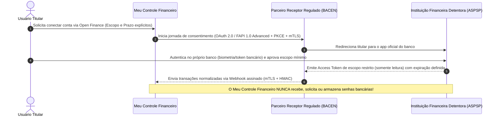

# Roteiro de Evolução e Melhorias Futuras — Meu Controle Financeiro

## 1. Integração Segura com Open Finance Brasil (Fase 2)

Na versão 1.0, seguindo o princípio de segurança máxima e conformidade regulatória, **não há integração direta não-regulada com instituições bancárias**. Para a Fase 2, a sincronização automática de saldos, extratos e faturas seguirá estritamente a regulamentação do **Banco Central do Brasil (BACEN)** para o ecossistema **Open Finance Brasil**:

### Requisitos Técnicos Obrigatórios para a Integração Open Finance:
1. **Parceiro Autorizado pelo BACEN**: Uso exclusivo de Instituição Receptora de Dados credenciada no Diretório de Participantes do Open Finance Brasil (com certificados digitais ICP-Brasil `e-CNPJ` / `QWAC` / `QSealC`).
2. **Consentimento Explícito, Granular e com Prazo de Expiração**:
   - O usuário escolhe exatamente quais contas ou cartões deseja compartilhar e por qual prazo (ex.: 3, 6 ou 12 meses), podendo revogar com 1 clique tanto na plataforma quanto no aplicativo do próprio banco.
3. **Princípio do Escopo Mínimo (Read-Only)**:
   - Solicitar exclusivamente escopos de leitura de saldo e extrato (`ACCOUNTS_READ`, `ACCOUNTS_BALANCES_READ`, `CREDIT_CARDS_ACCOUNTS_BILLS_READ`), sem escopos de iniciação de pagamento caso o usuário deseje apenas acompanhamento financeiro.
4. **Zero Armazenamento de Credenciais Bancárias**:
   - Proibição absoluta de técnicas de *screen scraping* ou coleta de agência/senha/token bancário.

---

## 2. Outras Evoluções Planejadas para o Produto

1. **Espaço Familiar Compartilhado com Permissões Granulares (RBAC Doméstico)**:
   - Permitir convidar parceiro(a) ou membros da família para visualizar e lançar despesas em um orçamento doméstico compartilhado, mantendo contas e metas individuais privadas quando desejado.
2. **Suporte a Passkeys / WebAuthn (FIDO2)**:
   - Adicionar autenticação sem senha (*passwordless*) e segundo fator via biometria nativa do dispositivo (Windows Hello, Touch ID, Face ID e chaves de segurança físicas YubiKey) em complemento ao TOTP RFC 6238.
3. **Leitura Local de Comprovantes e Notas Fiscais (OCR Privado + QR Code NFC-e)**:
   - Extração automática de valor, data e CNPJ a partir de comprovantes PIX ou QR Code de Nota Fiscal de Consumidor Eletrônica (NFC-e), processada de forma efêmera e sem retenção desnecessária.
4. **Aplicativo Web Progressivo (PWA Offline-First) com Criptografia Local**:
   - Permitir registrar despesas em dinheiro ou cartão mesmo sem conexão à internet (ex.: em viagens), sincronizando de forma segura assim que a conexão for restabelecida.
5. **Simulador de Independência Financeira e Reserva Ideal Personalizada**:
   - Calculadora educacional que cruza a estabilidade da renda (fixa vs. autônomo/freelancer) com o custo fixo mensal para recomendar 6 a 12 meses de reserva de emergência.
